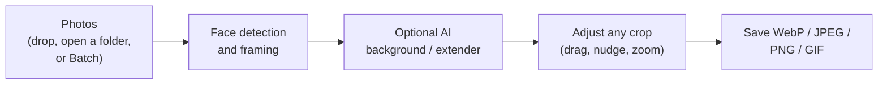

<p align="center">
  
</p>

<p align="center">
  <b>Convert, crop and size photos for websites and social media, in batches, on your own Mac.</b><br>
  Consistent headshots every time. AI background replacement and extension. Nothing leaves your computer.
</p>

<p align="center">
  <a href="LICENSE"></a>
  
  
  <a href="https://github.com/kev-williams/mosaic-photo-editor/releases"></a>
</p>

---

## Why Mosaic Photo-Editor

Staff pages, speaker lists and social posts look best when every photo is framed the same way.
Mosaic Photo-Editor finds each face and crops every photo so heads are the same size and sit at the
same height, then saves small, sharp files ready for the web.

- **Consistent headshots.** Face detection places the eyes about a third of the way down and sizes
  every head the same. Fine-tune any crop by dragging the frame.
- **Shapes for every use.** Profile 2:3, landscape 3:2, hero 16:9, social 1.91:1, square, or your own.
- **Small files.** WebP (default), JPEG, PNG or GIF, with an optional file-size cap per image.
- **AI background replacement.** Swap any backdrop for a plain colour (picker, hex code or eyedropper).
- **AI extender.** Not enough room above the head? It generates matching backdrop, and lengthens
  clothing below without smudging buttons or seams.
- **Batches.** Point it at a folder of hundreds of photos and review them in a grid before converting.
- **Remembers your work.** Photos you already exported in the last 7 days are marked with a **!**.
- **Private.** Runs entirely on your Mac. No accounts, no uploads, no tracking.

## Install (macOS)

You need macOS 12 or later and Python 3.10 to 3.13
([Homebrew](https://brew.sh): `brew install python@3.12`). Apple silicon is recommended for the AI features.

```bash
git clone https://github.com/kev-williams/mosaic-photo-editor.git "$HOME/Applications/Mosaic Photo-Editor"
cd "$HOME/Applications/Mosaic Photo-Editor"
./scripts/install.sh
```

The installer sets everything up and adds **Mosaic Photo-Editor** to `~/Applications`. Drag it to the
Dock. It opens in its own window; close the window (or press Cmd+Q, or use **Quit** in the sidebar)
and it stops completely, freeing all memory.

Update later with `git pull` and `./scripts/install.sh` again (only what changed is reinstalled).

## Using it



**Upload** is for quick jobs. Drop photos on the drop area, or use **Browse...** to pick photos or whole
folders anywhere on your Mac.
Pick the output format right under the photos. Each photo gets a crop editor and a large preview,
side by side and the same height.

- Drag the frame to move it, drag a corner to resize it, or use the arrow keys (Shift for bigger steps).
  The dashed line shows where the eyes should sit.
- **Headroom +/-**, **Zoom in/out** and **Move left/right** make small, exact steps. Changes show straight away.
- **After / Before** compares the result with the plain crop when background replacement or the AI
  extender is on (areas the AI will fill show as a checkerboard).
- **Download**, or **Save to Output folder**. A **!** next to Download means the photo was already
  processed with the same format and size in the last 7 days; hover it to see when.

**Batch** converts whole folders. Choose a folder, review every crop in a grid (filter by *Needs
attention*, *No face found*, *Adjusted* or *Processed before*), adjust any of them, then **Convert**.
Converted files go to `Output/<folder name>/<shape>/`. A CSV report is optional.

### The settings panel

Settings are grouped from top to bottom: **Output** (file names, quality), **Cropping** (shape, crop
position, file-size cap), **Head and face** and **Image background** (AI). Change as many as you like,
then press **Apply changes**: photos are only reprocessed once, so there is no waiting between clicks.

At the bottom: **Clear cached images** frees memory, **Hold to empty Input and Output** moves everything
in those two folders to the Trash (hold the button to confirm), and **History** shows or clears the record
of processed files.

### Recommended file-size caps

| Use | Cap |
|---|---|
| Thumbnail or card (up to 600 px) | 30-80 KB |
| Profile headshot (800x1200) | 100-150 KB |
| Content or article image (1200 px) | 150-250 KB |
| Hero or full-width banner (1920 px) | 250-400 KB |

The cap lowers quality step by step until the file fits, never below 40. JPEG files are usually
1.5-2x larger than WebP at the same quality.

## Where things are kept

| What | Where |
|---|---|
| The app (this repository) | wherever you cloned it, e.g. `~/Applications/Mosaic Photo-Editor` |
| App icon | `~/Applications/Mosaic Photo-Editor.app` |
| Your photos | `~/Pictures/Mosaic Photo-Editor/Input` and `Output` (you can also use any other folder) |
| Python environment, AI models, history, crop adjustments | `~/Library/Application Support/Mosaic Photo-Editor` |
| Logs | `~/Library/Logs/Mosaic Photo-Editor` (includes `timings.csv`, see Timing log in the sidebar) |

Photos never live inside the app folder, so they can't end up in git. Every location can be changed with an
environment variable (`MOSAIC_PHOTOS_DIR`, `MOSAIC_STATE_DIR`, `MOSAIC_LOG_DIR`).

## AI features

AI runs inside the app on your Mac's GPU (Apple Metal), or on an NVIDIA GPU or the CPU elsewhere. Models
download once, on first use. Each time the app opens they load in the background, so they are ready by
the time you need them (set `MOSAIC_AI_PRELOAD=0` to load them only on first use and save memory).

| Feature | Model | Licence | Download |
|---|---|---|---|
| Background replacement | [BiRefNet-portrait](https://huggingface.co/ZhengPeng7/BiRefNet-portrait) | MIT | about 900 MB |
| AI extender | [LaMa](https://github.com/advimman/lama) (big-lama) | Apache-2.0 | about 200 MB |
| Face detection (always included) | [YuNet](https://github.com/opencv/opencv_zoo/tree/main/models/face_detection_yunet) | MIT | 230 KB, in this repo |

Results are cached per photo, so after the first pass moving or zooming a crop is instant.
**Clear cached images** also unloads the models.

Want to try a different or fine-tuned cut-out model? Set `MOSAIC_AI_MODEL` to its Hugging Face id
(for example a BiRefNet variant). The model code is in [`mosaic/ai.py`](mosaic/ai.py).

## Docker (optional)

Prefer a container, or not on a Mac? Docker runs everything except the AI features (Docker can't use the
Mac's GPU).

```bash
cp docker/env.example docker/.env      # optional: change folders
docker compose -f docker/docker-compose.yml up -d --build
```

Open http://localhost:8501. Stop with `docker compose -f docker/docker-compose.yml down`.

## Uninstall

```bash
./scripts/uninstall.sh
```

Removes the app icon and the Python environment, and asks before removing models and history. Your photos
are never touched.

## Privacy

- Everything runs on your computer. Photos are never uploaded anywhere.
- No analytics: Streamlit usage statistics and Hugging Face telemetry are switched off.
- The only internet access is the one-time model download (Hugging Face and GitHub) when you first use an AI
  feature.
- The history database stores file names, sizes and dates, never image data.
- This repository refuses photos: `.gitignore` is an allowlist and a pre-commit check blocks image, raw,
  video and data files (see [CONTRIBUTING.md](CONTRIBUTING.md)).

## Project layout

| Path | What it does |
|---|---|
| `app.py` | Streamlit entry point: navigation and sidebar |
| `launcher.py` | Opens the app in its own window and stops it when the window closes |
| `mosaic/core.py` | Image processing: framing, cropping, extension, encoding. No interface code |
| `mosaic/ai.py` | AI models (background cut-out, extender) with per-photo caching |
| `mosaic/history.py` | SQLite history of processed files |
| `mosaic/ui/` | Interface: settings panel, Upload and Batch pages, crop editor component |
| `scripts/` | Install, build the app icon, uninstall, privacy check, release |
| `docker/` | Container setup (optional) |
| `tests/` | Tests (photos are generated in memory) |

## Contributing

Ideas, bug reports and pull requests are welcome. Start with [CONTRIBUTING.md](CONTRIBUTING.md), and please
never attach photos of real people to issues unless you have their permission.

## License

[MIT](LICENSE). Third-party models and libraries keep their own licences: see
[THIRD_PARTY_NOTICES.md](THIRD_PARTY_NOTICES.md).
